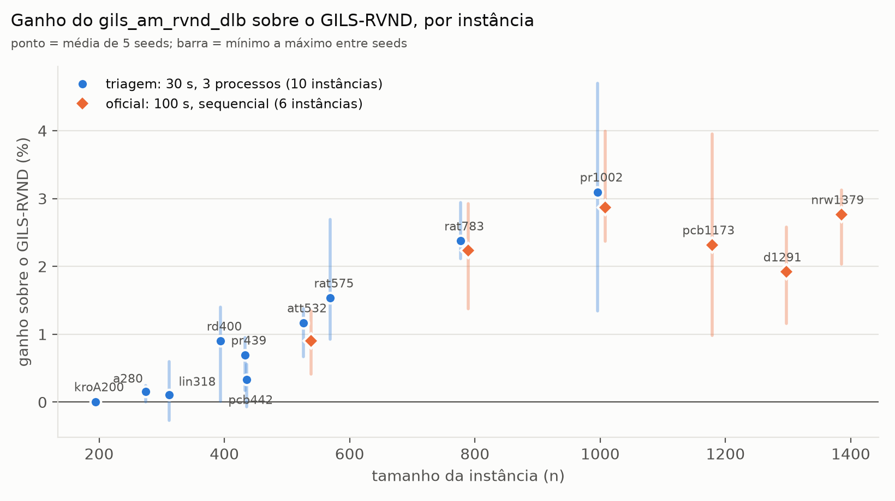
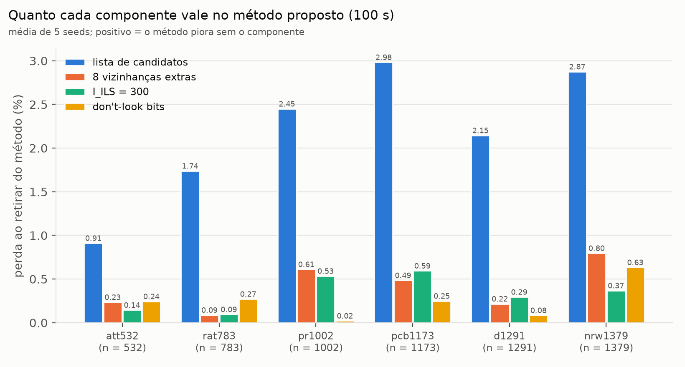
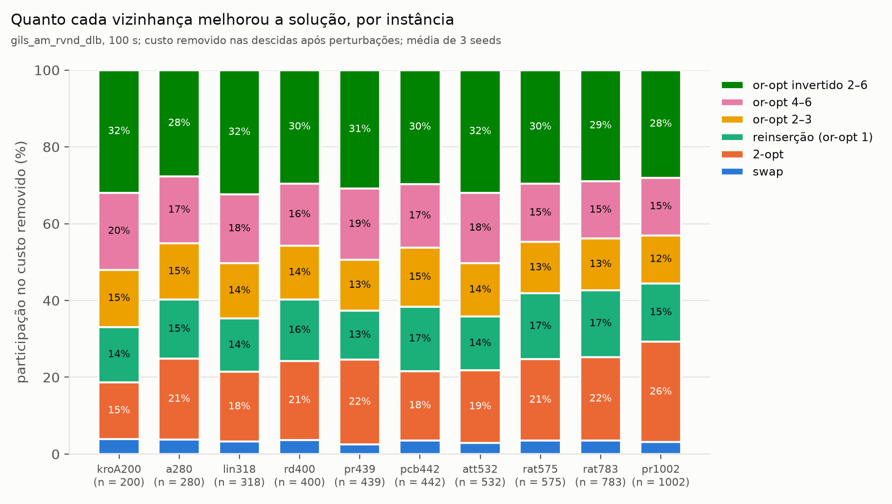

# Resumo dos resultados: ablação, MDM, irace e memória adaptativa

Este documento organiza as quatro frentes de trabalho que fecham a avaliação do
método proposto (`gils_am_rvnd_dlb`), mais um estudo complementar sobre a memória
adaptativa. Cada seção traz a pergunta, o protocolo, os números principais e a
conclusão; os detalhes estão no documento de cada estudo.

| # | frente | pergunta | resposta curta | documento |
|---|---|---|---|---|
| 1 | instâncias | o conjunto de teste cobre instâncias grandes? | sim: 77 TSPLIB, de 42 a 1 379 nós | [`registry.py`](../../scripts/registry.py) |
| 2 | ablação | quanto cada componente acrescenta ao GILS-RVND? | −2,17% no total; quatro componentes de busca local carregam o ganho | [ablation-gils-rvnd-to-dlb](ablation-gils-rvnd-to-dlb.md) |
| 3 | MDM do paper vs MDM do projeto | a reimplementação do MDM é compatível com a publicada? | sim em qualidade; não na redução de tempo | [mdm-paper-table1-reproduction](../benchmarks/mdm-paper-table1-reproduction.md) |
| 4 | irace | a configuração do método é boa, ou só uma escolha manual? | o tuning automático não acha nada melhor | [irace-dlb-tuning](../benchmarks/irace-dlb-tuning.md) |
| + | memória adaptativa | ela contribui por outros critérios? | sim em velocidade (−19% a −24%), não em qualidade | [H20](../hypotheses/h20-adaptive-memory-beyond-quality.md) |

O método proposto:

```bash
./bin/gils_am_rvnd <instancia.tsp> --rvnd-mode candidate-dlb --cand-k 12 --iils 300 --max-time 100
```

---

## 1. Instâncias

O registro de instâncias ([`scripts/registry.py`](../../scripts/registry.py)) passou a
ter as **77 instâncias TSPLIB** com até 1 379 nós, e os grupos `tsplib`, `tsplib-120`,
`tsplib-200` e `tsplib-500` para usar direto em `--instances`.

**Critério de seleção** usado nos estudos que comparam componentes (ablação, irace,
memória):

1. **n ≥ 500**, porque abaixo disso o método satura em 100 s (`pr226` acha a mesma
   solução em todas as seeds; `lin318` e `pr439` atingem a melhor conhecida), e pares
   empatados não informam nada.
2. **n ≤ ~1 400**, para que os braços com varredura completa `O(n²)` ainda completem
   algumas descidas em 100 s.
3. **Um representante por tipo de estrutura**: aleatória, agrupada, grade de placa de
   circuito, grade perturbada, furação, cidades reais.

| uso | instâncias |
|---|---|
| teste (ablação oficial, validação do irace, memória) | `att532`, `rat783`, `pr1002`, `pcb1173`, `d1291`, `nrw1379` |
| treino do irace (disjunto do teste) | `u574`, `rat575`, `p654`, `d657`, `u724`, `u1060`, `vm1084`, `rl1304` |
| triagem da ablação (n de 200 a 1 002, para ver o efeito crescer com n) | `kroA200`, `a280`, `lin318`, `rd400`, `pr439`, `pcb442`, `att532`, `rat575`, `rat783`, `pr1002` |

**Convenção de distância.** O arredondamento de `EUC_2D` acompanha a variante do
problema, como na literatura: **o caminho (o MLP do projeto) trunca**, como em
Salehipour et al. (2011) e Silva et al. (2012), cujos BKS o projeto reproduz exatamente;
**o circuito (`--closed`) usa o `nint` do TSPLIB**, como em Abeledo et al. (2010),
Bulhões et al. (2018) e no paper do MDM
([distance-types](../concepts/distance-types.md)).

---

## 2. Ablação: do GILS-RVND ao método proposto

**Protocolo.** Cadeia cumulativa (um componente acrescentado por passo) e
leave-one-out (um componente retirado do método final), a 100 s, sequencial, 6
instâncias com n ≥ 500, 5 seeds, todos os tours verificados. Uma triagem anterior a
30 s, em 10 instâncias, mediu cada vizinhança individualmente.

**Resultado.** O método proposto é **2,17% melhor que o GILS-RVND** e vence nas 30
seeds (30/0/0, p < 10⁻⁸). O ganho cresce com o tamanho da instância:



| instância | n | ganho (100 s) | ganho (triagem, 30 s) |
|---|---:|---:|---:|
| `kroA200` | 200 | — | 0,01% |
| `a280` | 280 | — | 0,16% |
| `lin318` | 318 | — | 0,11% |
| `rd400` | 400 | — | 0,90% |
| `pr439` | 439 | — | 0,69% |
| `pcb442` | 442 | — | 0,33% |
| `att532` | 532 | 0,90% | 1,17% |
| `rat575` | 575 | — | 1,54% |
| `rat783` | 783 | 2,23% | 2,38% |
| `pr1002` | 1 002 | 2,87% | 3,10% |
| `pcb1173` | 1 173 | 2,32% | — |
| `d1291` | 1 291 | 1,92% | — |
| `nrw1379` | 1 379 | 2,77% | — |

Abaixo de ~300 nós, as duas versões chegam praticamente à mesma solução. A partir de
~500, o ganho fica entre 1% e 3%. Nas três instâncias medidas nos dois lotes, a triagem
e o lote oficial concordam.

**Quanto vale cada componente.** Retirando um de cada vez do método final:



| retirado do método | perda média | V/E/D | p (Holm) |
|---|---:|---:|---:|
| lista de candidatos (K = 12) | **+2,18%** | 0/0/30 | < 0,0001 |
| 8 vizinhanças extras (or-opt 4–6 e or-opt invertido 2–6) | **+0,41%** | 6/0/24 | 0,007 |
| `I_ILS` = 300 (volta a 100) | **+0,34%** | 6/0/24 | 0,007 |
| *don't-look bits* | **+0,25%** | 7/0/23 | 0,016 |
| memória adaptativa | +0,02% | 8/7/15 | 0,42 |

**Por vizinhança** (triagem): só **2-opt** (+0,93% se retirado) e **reinserção**
(+0,53%) são indispensáveis sozinhas. As outras onze são substituíveis uma a uma, mas
não em bloco.

**Quanto cada vizinhança melhorou a solução.** O leave-one-out diz quais vizinhanças são
insubstituíveis. Uma pergunta diferente é quem fez o trabalho: somando, para cada
vizinhança, o custo removido por todos os movimentos que ela aplicou (flag
`--nb-stats`, método proposto, 100 s, 3 seeds, nas 10 instâncias da triagem). O gráfico
conta só as descidas após as perturbações, que são o trabalho do ILS. A primeira descida
a partir da construção é limpeza de uma rota ruim, varia muito entre execuções e
distorceria as proporções.



| vizinhança | custo removido (média das 10 instâncias) | movimentos aplicados | faixa entre instâncias (custo) |
|---|---:|---:|---:|
| swap | 3,4% | 6,3% | 2,5–3,9% |
| 2-opt | **20,3%** | 14,9% | 14,8–26,1% |
| reinserção (or-opt 1) | **15,3%** | **24,8%** | 12,8–17,4% |
| or-opt 2 | 8,0% | 8,4% | 7,1–9,2% |
| or-opt 3 | 6,0% | 4,6% | 5,4–6,8% |
| or-opt 4 | 5,7% | 3,3% | 4,7–6,7% |
| or-opt 5 | 5,6% | 2,7% | 4,9–6,6% |
| or-opt 6 | 5,8% | 2,5% | 4,8–6,8% |
| invertido 2 | 9,7% | 14,3% | 8,7–10,7% |
| invertido 3 | 6,1% | 6,7% | 5,4–6,8% |
| invertido 4 | 5,1% | 4,6% | 4,5–5,7% |
| invertido 5 | 4,6% | 3,6% | 4,1–5,2% |
| invertido 6 | 4,6% | 3,2% | 4,0–5,3% |

Leitura:

- **A divisão é estável entre instâncias.** Nenhuma vizinhança muda mais que alguns
  pontos percentuais de uma instância para outra. A exceção é o 2-opt, cuja fatia
  cresce com o tamanho, de 15% em `kroA200` para 26% em `pr1002`.
- **2-opt e reinserção fazem um terço do trabalho**, e são justamente as duas que o
  leave-one-out apontou como indispensáveis. A reinserção é a que mais aplica
  movimentos (25%), mas cada um remove pouco; o 2-opt aplica menos e remove mais.
- **As 8 vizinhanças extras fazem quase metade do trabalho**: or-opt 4–6 com ~17% e
  invertido 2–6 com ~30%. Isso é consistente com o leave-one-out: retiradas uma a uma
  não fazem falta, porque as vizinhanças próximas assumem o trabalho, mas retiradas
  juntas custam 0,41%.
- **O swap quase não contribui** (3%), o que também bate com o leave-one-out, onde
  retirá-lo não muda nada.

As duas medidas respondem perguntas diferentes. Esta diz **quem fez o trabalho**; o
leave-one-out diz **quem faria falta**. No RVND as vizinhanças disputam os mesmos
movimentos, e quem chega primeiro leva o crédito, então uma fatia grande não implica que
a vizinhança seja insubstituível.

**Conclusão.** O ganho é inteiramente de busca local e calibração. A lista de
candidatos domina, porque multiplica as iterações de ILS por 10× (`att532`) a 34× (`nrw1379`); as vizinhanças
extras gastam parte dessa velocidade em profundidade e só pagam depois da poda;
*don't-look bits* e `I_ILS` = 300 valem mais juntos que separados. A triagem a 30 s
tinha subestimado esses três últimos componentes; o lote oficial a 100 s corrigiu isso.

---

## 3. MDM-GILS-RVND: o do paper contra o do projeto

**Protocolo.** O do paper de Santana, Plastino & Rosseti (arXiv:1908.10705): variante
circuito, `I_max` = 10, `I_ILS` = min(100, n), 10 execuções por instância, nas 28
instâncias da Tabela 1 com n ≤ 318. Só a Tabela 1 é comparável instância a instância:
as instâncias Salehipour das Tabelas 2 e 3 não são públicas, e as do projeto foram
regeradas.

**Resultado.**

| | diferença média das médias (nossa vs paper) | nossa média melhor / igual / pior | p | melhor solução igual à do paper |
|---|---:|---:|---:|---:|
| GILS-RVND | −0,0007% | 7/12/9 | 0,80 | 26 de 28 |
| MDM-GILS-RVND | +0,0072% | 5/12/11 | 0,21 | 24 de 28, e 1 melhor |

| efeito do MDM sobre o GILS-RVND | paper | projeto |
|---|---:|---:|
| qualidade (diferença das médias) | −0,004% | +0,004% |
| tempo | **−15,2%** | **−1,1%** |

**Conclusão.** As implementações são **compatíveis em qualidade**: mesmas médias dentro
da variação entre seeds, todos os ótimos provados atingidos pelo GILS-RVND (17 de 18
pelo MDM), e a mesma relação de qualidade entre os dois algoritmos. A **redução de
tempo** do MDM não se reproduz. A causa provável é o GILS-RVND original reconstruir
matrizes n × n a cada movimento: ali, partir de soluções construídas com padrões poupa
muitos movimentos caros. No projeto essa reconstrução é `O(n)`, e a economia some
(hipótese, não medida).

---

## 4. irace: a configuração do método

**Protocolo.** irace sobre `--cand-k` (6–30), `--cand-maxlen` (3–8), or-opt invertido
(ligado/desligado) e `--iils` (50–1 000), a 100 s, partindo da configuração atual.
Treino em 8 instâncias com n ≥ 500, separadas das 6 de teste. 600 experimentos.
Validação da melhor configuração contra a atual, sequencial, 10 seeds.

**Resultado.**

| | `cand-k` | `cand-maxlen` | invertido | `I_ILS` |
|---|---:|---:|---|---:|
| atual | 12 | 6 | ligado | 300 |
| melhor do irace | 14 | 7 | ligado | 396 |

Na validação, em instâncias que o irace não viu: **+0,100%** para a configuração do
irace (24/0/36, p = 0,155), um **empate**.

**Conclusão.** A configuração atual está numa região plana perto do ótimo: o irace
converge para perto dela (K 13–14, maxlen 6–7, `I_ILS` 289–499) e descarta os extremos
(K alto, blocos curtos, sem or-opt invertido). A configuração fica, agora com
justificativa formal, e o método não depende de ajuste fino.

---

## 5. Complemento: a memória adaptativa

**Pergunta.** A ablação mostrou que a memória adaptativa não melhora a qualidade a tempo
fixo. Ela contribui por outros critérios?

**Protocolo.** λ = 0 (sem memória) contra λ = 0,5 no mesmo binário, isolando só a
memória, com um rastro por reinício. Iterações fixas (4 instâncias, n de 200 a 439) e
tempo fixo de 100 s com `I_ILS` = 30 e 300 (as 6 de teste).

**Resultado.**

| critério | resultado |
|---|---|
| tempo, a iterações fixas | **−19% a −24%** para a mesma qualidade (p ≤ 0,012) |
| qualidade, 100 s, método proposto | empate (+0,004%) |
| custo ao longo do tempo, `I_ILS` = 30 | −0,29% aos 10 s (p = 0,0015); não se sustenta |
| diversidade dos reinícios | menor: distância até a melhor solução cai de 36% para 22% dos nós |

**Conclusão.** A memória é um mecanismo de **eficiência**. A construção praticamente
copia a melhor solução já vista, então cada reinício é mais curto. O preço é
diversidade: até 26% dos reinícios voltam ao mesmo ótimo. A tempo fixo, o tempo
economizado vira mais reinícios, mas menos diversos, e a qualidade empata. No método
proposto, ela quase não age: em 19 de 30 execuções há um só reinício.

---

## 6. O que fica para a dissertação

1. **Resultado principal:** o método proposto bate o GILS-RVND por 2,17% a 100 s em
   instâncias com n ≥ 500 (30/0/0), com ganho crescente com n.
2. **De onde vem:** busca local (lista de candidatos, vizinhanças extras,
   *don't-look bits*) e calibração (`I_ILS` = 300); cada um é significativo quando
   retirado.
3. **A base de comparação é fiel:** o MDM do projeto reproduz a qualidade publicada;
   o desvio em tempo está documentado e explicado.
4. **A configuração é justificada:** o irace não encontra nada melhor.
5. **A memória adaptativa** deve ser apresentada como mecanismo de eficiência, não de
   qualidade.

## Reproduzir

| o quê | comando |
|---|---|
| ablação oficial | `python3 scripts/ablation.py --suite official100 --out results/ablation/ablation_100s.json` |
| comparação com o paper do MDM | `python3 scripts/mdm_paper_compare.py --out results/mdm-paper/table1.json --max-n 318` |
| irace | `cd irace && irace --scenario scenario-dlb.txt` |
| validação do irace | `python3 scripts/run_experiments.py --mode fixed-time --time-limit 100 --runs 10 --instances att532 rat783 pr1002 pcb1173 d1291 nrw1379 --solvers gils_am_rvnd_dlb gils_am_rvnd_irace` |
| memória adaptativa | `python3 scripts/am_study.py --suite fixed100 --out results/am-study/fixed100.json` |
| participação de cada vizinhança | `python3 scripts/nb_contrib.py --out results/nb-contrib/nb_100s.json` |
| gráficos deste documento | `python3 scripts/plot_summary.py` e `python3 scripts/nb_contrib.py --report-only ...` (precisam de `matplotlib`) |

Todos os comandos com `--out` aceitam `--report-only` para só regenerar as tabelas.
